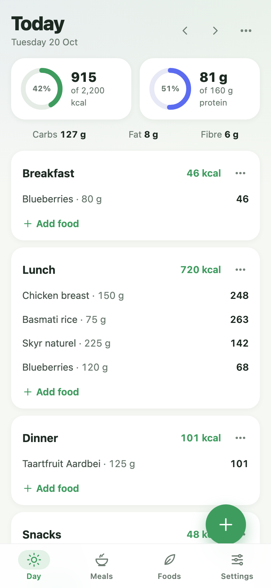
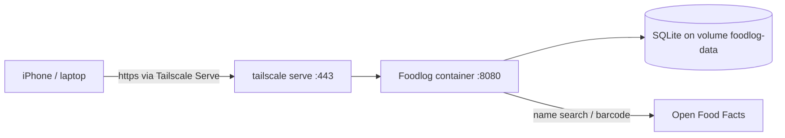

# Foodlog

A personal food **day planner**. Plan what you'll eat, see how the day adds up
against your calorie and protein targets, and reuse your usual meals with one
tap. It runs in Docker on a Raspberry Pi and is reachable from your phone and
laptop over your Tailscale tailnet.



- **Day planner:** Breakfast, Lunch, Dinner and Snacks, with rings for kcal and
  protein against your targets, plus carbs, fat and fibre totals. Copy a previous day,
  move or resize entries, and save a meal section as a reusable meal.
- **Your foods:** a personal ingredient database with values per 100 g and
  optional portions (e.g. "1 pot = 150 g"). Editing an ingredient updates today
  and future plans; past days stay as they were.
- **Lookup:** search [Open Food Facts](https://world.openfoodfacts.org) by name
  (Dutch products first, configurable) or scan a barcode with the phone camera.
- **Saved meals:** build meals like "Chicken rice bowl" once and add them at
  ×0.5 to ×2.
- **Backups:** export everything as JSON and restore it later.

No accounts and no login: it's a single-user app, and your tailnet decides who
can reach it.

## How it works



- A small Node 24 server (`node:http` + built-in `node:sqlite`, no runtime npm
  packages) serves a JSON API under `/api` and a plain HTML/CSS/JS frontend
  with no build step.
- Open Food Facts results are **copied** into your own database when you pick
  them, so after that everything works from your local copy.
- On iPhone, Safari has no built-in barcode reader, so the app loads a bundled
  ZXing WebAssembly decoder from `/vendor/`, served by the app itself and
  never from a CDN.

## Deploy on the Raspberry Pi

Requirements: a 64-bit Raspberry Pi OS (Pi 4 or 5), Docker with the Compose
plugin, and Tailscale.

```bash
git clone <this repo> foodlog && cd foodlog
docker compose up -d --build
```

The app now listens on `127.0.0.1:8080` on the Pi, so it is deliberately
unreachable from the rest of your home network.

If port 8080 is already in use ("port is already allocated"), choose another
one in a `.env` file next to `docker-compose.yml`. Compose reads it
automatically, and updates won't overwrite it:

```bash
echo "FOODLOG_PORT=8087" > .env
docker compose up -d
```

Then use that port in the `tailscale serve` command below. Tailscale Serve makes it
available on your tailnet.

### Put it on your tailnet with HTTPS

Tailscale Serve gives the app a real certificate on your tailnet name. HTTPS is
also what lets the phone camera scan barcodes:

1. In the Tailscale admin console, under **DNS**, enable **MagicDNS** and
   **HTTPS Certificates** (one-time).
2. On the Pi:

   ```bash
   sudo tailscale serve --bg 8080
   ```

3. Open `https://<pi-name>.<tailnet-name>.ts.net` on your phone.
   `tailscale serve status` shows the exact address.

The setting persists across reboots. Only devices on your tailnet can open
that address.

### Add it to your iPhone home screen

Open the https address in Safari → Share → **Add to Home Screen**. It opens
full-screen like an app.

### Updating

```bash
git pull
docker compose up -d --build
```

Your data lives in the `foodlog-data` volume and survives rebuilds.

## Backups

- **In the app (easiest):** Settings → Export downloads a JSON file. Settings →
  Import replaces everything with a backup. Before replacing anything, the server
  saves the current data to `/data/backups/pre-import-<time>.json` in the volume,
  so an import can always be undone by importing that file.
- **The database file:** SQLite keeps recent changes in a side file (`-wal`)
  while the app runs, so copy the database only while the app is stopped:

  ```bash
  docker compose stop app
  docker compose cp app:/data/foodlog.db ./foodlog-backup.db
  docker compose start app
  ```

  To restore it, stop the app, remove any leftover `foodlog.db-wal` and
  `foodlog.db-shm`, then copy the file back in:

  ```bash
  docker compose stop app
  docker compose run --rm --no-deps --entrypoint sh app -c 'rm -f /data/foodlog.db-wal /data/foodlog.db-shm'
  docker compose cp ./foodlog-backup.db app:/data/foodlog.db
  docker compose start app
  ```

## Configuration

| Variable       | Default            | Purpose                                                    |
| -------------- | ------------------ | ---------------------------------------------------------- |
| `FOODLOG_PORT` | `8080`             | Host port (on 127.0.0.1) in `.env`; point `tailscale serve` at it |
| `PORT`         | `8080`             | Port inside the container                                  |
| `DB_PATH`      | `/data/foodlog.db` | SQLite file (on the `foodlog-data` volume)                 |
| `TZ`           | `Europe/Amsterdam` | Decides what "today" means when ingredient edits update plans |

## Development

Everything runs through Docker Compose:

```bash
# tests and lint
docker compose --profile test run --rm test npm test
docker compose --profile test run --rm test npm run lint

# run the app from your working copy on http://localhost:8081
docker compose --profile test run --rm -p 8081:8080 test npm start
```

Project layout:

```
server/              API: router, SQLite schema, one module per domain
  ingredients.js     foods, portions, archive, future-plan sync
  meals.js           saved meals
  days.js            planned days, add meal, copy day
  off.js             Open Food Facts client
  backup.js          export / import
public/              frontend (no build step)
  js/shared/         nutrition maths, dates, constants — used by server and browser
  js/views/          Day, Meals, Foods, Settings
  js/ui/             sheet, rings, food search, amount picker, forms
  js/scanner.js      camera barcode scanning
test/                node:test suites (Open Food Facts is always mocked)
```

Product data © Open Food Facts contributors, available under the
[Open Database License](https://opendatacommons.org/licenses/odbl/1-0/).
